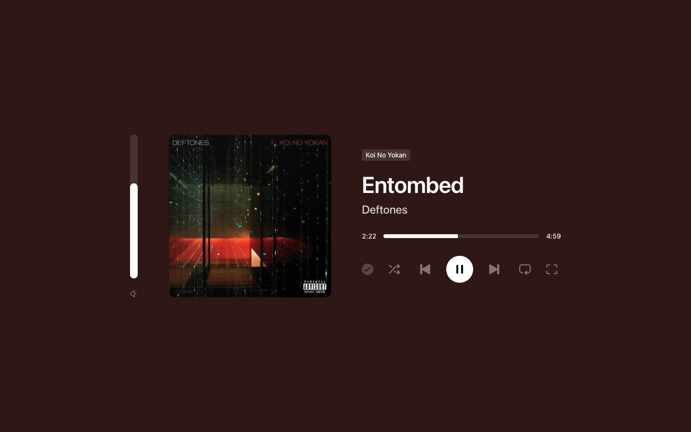
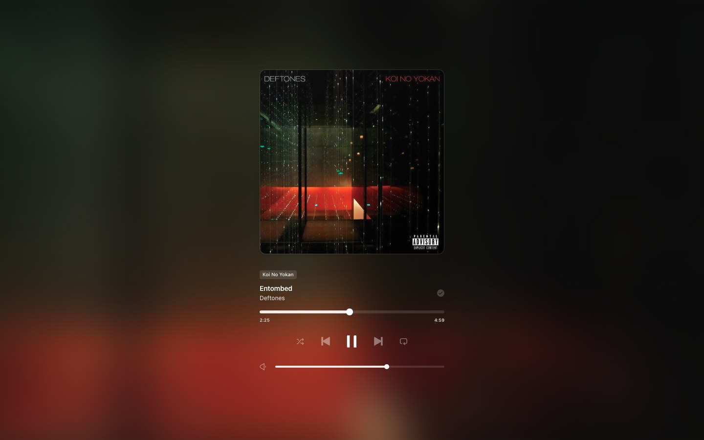
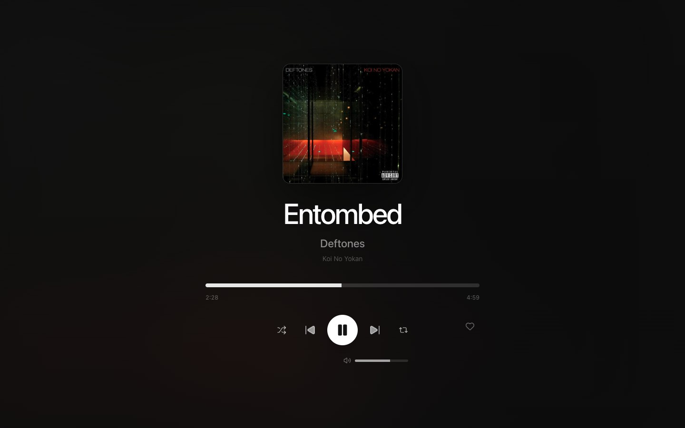
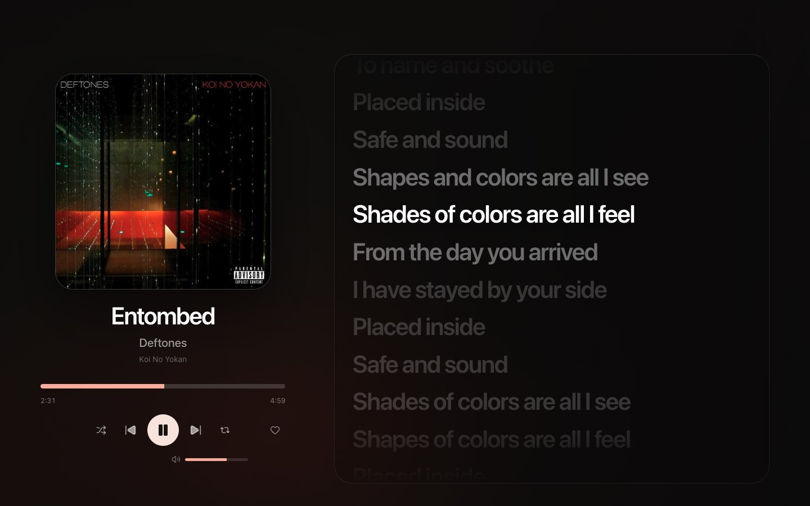

# Nowframe

Sua música, em outra tela. O Nowframe transforma um display secundário em uma experiência visual personalizável para acompanhar e controlar a reprodução do Spotify.

O aplicativo é um controle remoto visual: o áudio continua no dispositivo ativo do Spotify, enquanto o Nowframe mostra capa, progresso, letras e listas de faixas e oferece controles de reprodução.

Este é um projeto pessoal, desenvolvido para uso próprio e compartilhado para quem quiser experimentar. Não há garantia de suporte, atualizações regulares ou funcionamento em todos os dispositivos e versões de sistema.

## Prévia dos temas

Quatro exemplos do Nowframe acompanhando a mesma música no Spotify. Clique em uma imagem para vê-la em tamanho maior.

| Ambient                                                                                                                                       | Spotlight                                                                                                                                           |
| --------------------------------------------------------------------------------------------------------------------------------------------- | --------------------------------------------------------------------------------------------------------------------------------------------------- |
| [](docs/assets/previews/ambient.jpg) | [](docs/assets/previews/spotlight.jpg) |
| Minimalist                                                                                                                                    | Lyrics                                                                                                                                              |
| [](docs/assets/previews/minimalist.jpg)           | [](docs/assets/previews/lyrics.jpg)               |

Perfil e nome do dispositivo foram ocultados nas capturas. Capas e informações musicais pertencem aos seus respectivos titulares.

## Estado atual

- Aplicação desktop para macOS, Windows e Linux com Electron, React, Vite e TypeScript.
- Login Spotify com Authorization Code + PKCE, sem Client Secret no aplicativo.
- Controles de reprodução, volume, aleatório, repetição e biblioteca.
- Treze temas disponíveis: Ambient, Arcade Select, CD Cover, Default, Drive, Karaoke, Lyrics, Minimalist, Poster, Setlist, Spotlight, Tracklist e Vinyl. Cassette, Prism e Rocket League estão temporariamente ocultos.
- Letras sincronizadas via LRCLIB quando disponíveis.

## Limitações

- **Áudio:** o Nowframe não substitui o Spotify nem reproduz áudio. Inicie a reprodução em um cliente Spotify usando a mesma conta; o Nowframe acompanha e controla o dispositivo ativo.
- **Atualização do player:** mudanças feitas diretamente no Spotify são detectadas por consultas periódicas à API, então pode haver um pequeno atraso na interface.
- **Letras:** dependem do conteúdo disponível no LRCLIB. Algumas músicas não possuem letra sincronizada, e o acompanhamento por palavra nem sempre está disponível. Lyrics e Karaoke não mostram letras sem sincronização por padrão.
- **Tracklist:** nem toda lista visível no Spotify pode ser consultada pela Web API. Rádios, mixes, playlists de recomendações e conteúdos sem permissão de acesso podem não mostrar a lista de faixas.
- **Controles:** algumas ações podem ser restritas pelo Spotify, pelo dispositivo ou pelo contexto de reprodução. Volume e outros controles nem sempre estão disponíveis.
- **API:** o modo de desenvolvimento do Spotify limita usuários e chamadas. Em caso de limite excedido, o aplicativo precisa aguardar antes de continuar as consultas.

O projeto não é um aplicativo oficial do Spotify. A disponibilidade dos recursos depende das APIs e dos serviços externos utilizados.

## Estrutura do repositório

```text
apps/
  desktop/  Electron, React, Vite e TypeScript
docs/       Arquitetura, decisões, desenvolvimento, guias e releases
```

As aplicações futuras (`web` e `api`) serão adicionadas somente quando houver uma necessidade concreta. Código compartilhado permanece dentro da aplicação proprietária até existir uma segunda utilização real.

## Requisitos

- Git e Node.js 22.12 ou superior, com npm.
- Uma conta Spotify e acesso ao [Spotify Developer Dashboard](https://developer.spotify.com/dashboard).
- Spotify Premium: o proprietário do app precisa de Premium ativo em Development Mode, e os controles de reprodução também exigem uma conta compatível com os endpoints do player.
- Conexão com a internet e um cliente Spotify para reproduzir o áudio, no computador, celular ou outro dispositivo da mesma conta.

O projeto não inclui um Client ID compartilhado. Para usar sua cópia, crie seu próprio app no Spotify e configure o Client ID localmente.

## Configurar o Spotify

1. Acesse o [Spotify Developer Dashboard](https://developer.spotify.com/dashboard), entre na sua conta e selecione **Create app**.
2. Preencha **App name** e **App description** com um nome e uma descrição à sua escolha.
3. Em **Redirect URIs**, adicione exatamente:

   ```text
   http://127.0.0.1:8888/callback
   ```

4. Na pergunta **Which API/SDKs are you planning to use?**, marque **Web API**. O **Web Playback SDK** não é necessário na versão atual; se ele já estiver marcado no seu app, não é preciso desmarcar. O Nowframe controla o Spotify, mas não reproduz áudio.
5. Deixe **Bundle IDs** e **Android packages** vazios: esta configuração é para o aplicativo Electron, não para os SDKs de iOS ou Android.
6. Aceite os termos e salve o app. Abra suas configurações e copie o **Client ID**.

Não copie o **Client Secret** para o projeto. O login usa Authorization Code com PKCE, que não precisa desse segredo no aplicativo desktop.

A URI do Dashboard e a do `.env.local` precisam ser iguais. Use `127.0.0.1`, não `localhost` nem `127.0.01`. Se você já cadastrou `http://127.0.0.1:3000/callback`, pode mantê-la, desde que configure essa mesma URI no `.env.local` e a porta esteja livre durante o login.

Em **Development Mode**, confira em **Settings → Users Management** se a conta que fará login está autorizada. Para compartilhar o mesmo Client ID com outra pessoa, adicione a conta dela nessa lista. Cada pessoa também pode criar seu próprio app, sem usar o Dashboard de quem desenvolveu o Nowframe. Consulte as [regras atuais de Development Mode](https://developer.spotify.com/documentation/web-api/concepts/quota-modes).

## Instalar e executar

### 1. Clonar e instalar

```bash
git clone https://github.com/williamdbc/nowframe.git
cd nowframe
npm --prefix apps/desktop install
```

Todos os comandos abaixo são executados na raiz do repositório, dentro de `nowframe`.

### 2. Criar o arquivo de configuração

Copie `apps/desktop/.env.example` para `apps/desktop/.env.local`.

No macOS ou Linux:

```bash
cp apps/desktop/.env.example apps/desktop/.env.local
```

No Windows, usando PowerShell:

```powershell
Copy-Item apps/desktop/.env.example apps/desktop/.env.local
```

Edite `apps/desktop/.env.local` e substitua `seu_client_id` pelo Client ID do seu app:

```dotenv
MAIN_VITE_SPOTIFY_CLIENT_ID=seu_client_id
MAIN_VITE_SPOTIFY_REDIRECT_URI=http://127.0.0.1:8888/callback
```

O `.env.local` é ignorado pelo Git. Não altere o `.env.example` para incluir suas configurações pessoais.

### 3. Iniciar o Nowframe

```bash
npm --prefix apps/desktop run dev
```

Na janela do app, conecte sua conta Spotify e autorize o acesso no navegador. Depois, inicie uma música no Spotify usando a mesma conta. O Nowframe acompanhará a reprodução, mesmo que o áudio esteja tocando em outro dispositivo.

Se alterar o `.env.local`, pare e inicie novamente o processo de desenvolvimento. O callback local é aberto pelo próprio Nowframe durante o login; não precisa de um servidor separado.

Para resolver erros de login, falta de dispositivo ativo ou limites da API, consulte [desenvolvimento local](docs/development/local-setup.md#problemas-comuns).

## Gerar builds

Configure o `.env.local` antes de gerar o build: o Client ID e a Redirect URI são incorporados ao aplicativo nessa etapa. Alterar o `.env.local` depois não modifica um instalador já gerado; é preciso gerar o build novamente.

Execute na raiz do repositório:

| Comando                                      | Resultado                                                               |
| -------------------------------------------- | ----------------------------------------------------------------------- |
| `npm --prefix apps/desktop run build`        | Compila para `apps/desktop/out/`, sem criar instalador.                 |
| `npm --prefix apps/desktop run build:unpack` | Gera o aplicativo descompactado para teste; no macOS, um bundle `.app`. |
| `npm --prefix apps/desktop run build:mac`    | Gera o pacote macOS, incluindo `.app` e instalador `.dmg`.              |
| `npm --prefix apps/desktop run build:win`    | Gera o instalador Windows `.exe` (NSIS).                                |
| `npm --prefix apps/desktop run build:linux`  | Gera AppImage, Snap e DEB para Linux.                                   |

Os pacotes ficam em `apps/desktop/dist/`. O `.app` fica dentro de uma subpasta, como `dist/mac-arm64/Nowframe.app`; os nomes e as subpastas dependem da plataforma e da arquitetura.

Prefira gerar e testar os pacotes no sistema operacional de destino. Compilação cruzada pode exigir ferramentas adicionais e não funciona para todas as combinações de sistemas.

Os builds atuais não têm uma configuração de distribuição pública com assinatura e notarização, então podem apresentar avisos do sistema operacional. Consulte o [guia de build desktop](docs/guides/build-desktop.md) para detalhes e validação do pacote.

## Documentação

- [Índice da documentação](docs/index.md)
- [Visão geral da arquitetura](docs/architecture/overview.md)
- [Sincronização e integrações](docs/architecture/playback-and-integrations.md)
- [Sistema de temas](docs/architecture/theme-system.md)
- [Como adicionar um tema](docs/development/adding-a-theme.md)
- [Gerar builds desktop](docs/guides/build-desktop.md)
- [Release notes](docs/releases/)

## Qualidade

```bash
npm --prefix apps/desktop run format:check
npm --prefix apps/desktop run typecheck
npm --prefix apps/desktop run lint
npm --prefix apps/desktop run test
npm --prefix apps/desktop run build
```

## Licença

O código do Nowframe está disponível sob a [licença MIT](LICENSE). Você pode usar, modificar e distribuir o aplicativo, incluindo criar seus próprios temas, mantendo os avisos de autoria e a licença.

Essa licença se aplica ao código do projeto. Capas de álbuns, letras, marcas e demais conteúdos de terceiros continuam sujeitos aos direitos e termos de seus respectivos titulares.
