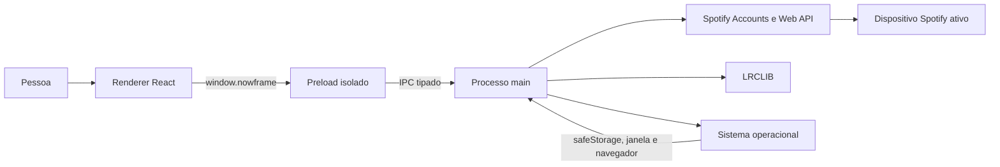

# Visão geral da arquitetura

## Contexto

O Nowframe transforma uma segunda tela em um display e controle remoto visual para o Spotify. O Spotify continua sendo responsável pelo dispositivo e pelo áudio; o Nowframe consulta e controla a sessão existente e apresenta os dados em layouts próprios.

O repositório contém hoje uma única aplicação implantável, `apps/desktop`. A estrutura aceita futuras aplicações `web` ou `api`, mas elas e qualquer pacote compartilhado só devem surgir quando houver uma segunda necessidade real.

## Objetivos e não objetivos

Objetivos atuais:

- autenticar uma conta Spotify com segurança em um cliente desktop;
- mostrar e controlar a reprodução em uma interface landscape;
- permitir layouts completos e independentes sobre o mesmo estado de domínio;
- manter a percepção de tempo fluida apesar da Web API ser consultada periodicamente;
- gerar aplicativos para macOS, Windows e Linux.

Não objetivos atuais:

- reproduzir áudio dentro do Electron;
- substituir o cliente Spotify ou escolher um dispositivo de reprodução;
- oferecer backend, sincronização entre instalações ou versão web;
- armazenar Client Secret no aplicativo distribuído.

## Visão do sistema



O renderer nunca acessa Node.js, Electron, tokens ou APIs externas diretamente. Toda capacidade privilegiada atravessa o contrato compartilhado e a ponte mínima do preload.

## Componentes

| Componente      | Responsabilidade                                                                                                                  |
| --------------- | --------------------------------------------------------------------------------------------------------------------------------- |
| `src/main`      | Ciclo de vida Electron, janela, OAuth, armazenamento de sessão, validação de entrada, Spotify Web API, LRCLIB e resiliência HTTP. |
| `src/preload`   | Expõe em `window.nowframe` somente operações permitidas pelo contrato IPC.                                                        |
| `src/contracts` | Define canais, entradas e respostas compartilhadas entre os processos.                                                            |
| `src/renderer`  | Rotas, cache assíncrono, estado otimista, relógio visual, temas e interação.                                                      |

A janela usa `contextIsolation`, desativa `nodeIntegration` e mantém o sandbox ativo. Novas janelas são negadas; URLs HTTPS solicitadas pelo conteúdo são abertas pelo navegador padrão.

## Organização do renderer

```text
src/renderer/src/
├── features/
│   ├── albums/
│   ├── app-bootstrap/
│   ├── authentication/
│   ├── library/
│   ├── lyrics/
│   ├── playback/
│   ├── playlists/
│   ├── themes/
│   └── window-controls/
├── routes/
└── shared/
```

Rotas apenas conectam navegação e páginas. Cada feature encapsula services IPC, query keys, hooks, tipos e componentes. O estado remoto usa TanStack Query; estado de domínio não é duplicado em efeitos locais quando pode permanecer no cache.

O router usa hash history porque o build empacotado carrega o renderer por `file://`:

- `#/login` apresenta a conexão com o Spotify e redireciona sessões válidas;
- `#/` fica sob o layout pathless `_authenticated` e apresenta o player;
- login e logout atualizam o cache da sessão antes da navegação.

## Fluxos principais

### Inicialização

1. O processo main registra os handlers IPC e cria a `BrowserWindow`.
2. O renderer consulta nome, versão e configuração Spotify.
3. O guard de rota consulta a sessão armazenada e escolhe login ou display.
4. O display carrega perfil, reprodução e apenas os dados extras exigidos pelo tema ativo.

### Autenticação

1. O main gera `code_verifier`, `code_challenge` S256 e `state`.
2. Um servidor loopback temporário escuta o callback configurado.
3. O navegador padrão abre a autorização do Spotify.
4. O main valida o `state`, troca o código por tokens e cifra a sessão com `safeStorage`.
5. O access token é renovado com antecedência; sessão revogada, inválida ou sem os scopes atuais é removida.

### Reprodução e apresentação

1. TanStack Query consulta o estado reduzido do player por IPC.
2. Um relógio monotônico local projeta o progresso entre respostas.
3. Comandos atualizam o cache de forma otimista quando a intenção é conhecida e reconciliam com o Spotify.
4. O tema ativo recebe o mesmo contrato de dados e ações, sem conhecer IPC ou tokens.
5. O processo main controla fullscreen; eventos IPC mantêm a interface sincronizada e `Escape` encerra a apresentação.

## Dados e persistência

- Access token, refresh token, expiração e scopes ficam cifrados no diretório `userData` do Electron.
- O renderer recebe apenas estado de sessão, perfil público reduzido e contratos de reprodução.
- A preferência de tema fica no `localStorage` com a chave `nowframe:selected-theme`.
- Não existe banco de dados, backend próprio ou persistência em nuvem.

## Aspectos transversais

- Entradas IPC vindas do renderer são tratadas como `unknown` e validadas no processo main.
- Respostas externas são validadas com Zod antes de serem mapeadas para o contrato interno.
- Chamadas externas usam conexões persistentes e tempos limite configurados no processo main.
- O `Retry-After` do Spotify impede novas consultas periódicas até o instante indicado.
- Testes de contrato garantem que todos os temas continuem oferecendo as capacidades obrigatórias.

## Documentos relacionados

- [Sincronização e integrações](playback-and-integrations.md)
- [Sistema de temas](theme-system.md)
- [PKCE e fronteira entre processos](../decisions/0002-pkce-and-electron-process-boundary.md)
- [Referência de configuração](../reference/configuration.md)
